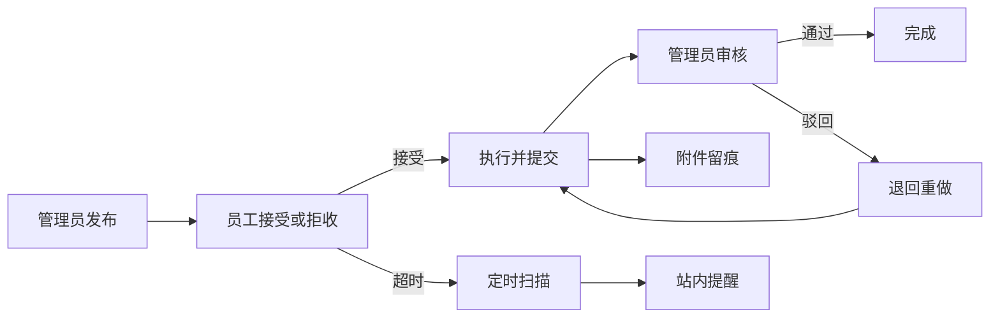
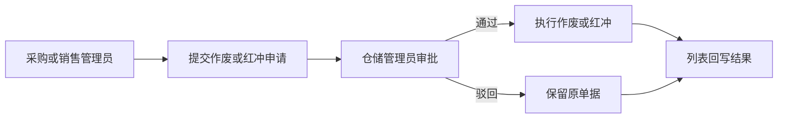

# 企业协同运营管理系统（ECS）

## 关于本项目

企业协同运营管理系统（ECS）是一套面向企业多部门协同与运营治理的管理系统，以进销退存与库存预警为核心业务主线，采用前后端分离架构，覆盖认证授权、用户与部门管理、基础资料、统计分析等核心能力。

在进销存流程基础上，系统进一步补齐了工作要求闭环、历史单据审批作废/红冲、公告定向投放、站内消息提醒与超时治理，并提供两类智能能力：面向项目知识问答的智能助手，以及可自主调用库存、销售工具并支持多轮追问的数据 Agent。前端使用 Vue 3，后端使用 Spring Boot 与 Spring AI 接入 DeepSeek，数据存储使用 MySQL。

## 🎯 适用业务场景 / 适合谁用

本项目适合采购、销售、仓配、财务、人事等多角色协同的中小型企业，也适合希望把进销存管理、部门协作、审批流转、项目内智能问答与数据 Agent 放在同一套系统中的团队。

如果你的业务同时涉及商品进销退存、岗位权限区分、任务与公告协同、历史单据审批，并且希望用自然语言直接查询库存和销售数据，这套系统会比较匹配。

## 🌐 在线演示

- 🔗 演示网站：https://wmsystem123.pages.dev/
- 📌 演示网站无智能助手功能，建议本地部署后体验完整功能。
- 🚀 快速部署链接：[快速部署](#quick-start)


## ✨ 项目亮点

本项目不只停留在传统进销存能力上，还把智能助手与数据 Agent 接入到项目知识、角色权限、页面入口与业务流程之中，让“查流程、问职责、找页面、看规则、查库存、看销售”可以和日常业务处理放在同一套系统内完成。

| 维度 | 亮点 | 价值 |
|---|---|---|
| 项目智能助手 | 面向项目知识问答的内置助手，而非通用聊天窗口 | 更适合回答系统流程、角色职责、页面入口、业务规则等项目内问题 |
| 智能助手联动 | 与角色权限、页面入口、项目文档、历史会话和模型路由打通 | 用户不必反复翻文档或找页面，能直接在系统内获得针对当前项目的答案 |
| 多模型能力 | 支持通义千问、智谱 GLM、Kimi、DeepSeek，并结合默认模型与回退链路 | 在可用性、成本与回答稳定性之间做平衡，减少单模型不可用带来的影响 |
| 数据 Agent | 基于 Spring AI 与 DeepSeek 的只读数据智能体，由模型自主选择库存不足、库存明细、按商品销售、销售概览工具 | 用户可以直接用自然语言查库存和销售，多轮追问复用上一轮商品，且严格沿用现有角色权限 |
| 权限模型 | 角色 + 部门双维权限控制 | 更贴近真实企业组织结构与权限边界 |
| 部门协同 | 人事、采购、销售、仓储、财务拥有独立工作台 | 不同岗位看到的菜单、首页指标和业务入口各不相同 |
| 任务闭环 | “工作要求”覆盖发布、接受、执行、提交、审核全流程 | 将跨部门任务转为可跟踪、可回看、可审核的闭环流程 |
| 审批追溯 | 历史单据不能直接处理，需经审批中心（仓储管理员）审批后作废或红冲 | 保留审批轨迹与处理结果，提升业务可控性 |
| 消息协同 | 待办提醒、站内邮箱与超时通知统一收口 | 关键消息前置展示，减少遗漏处理成本 |
| 时效治理 | 超时状态独立记录，统一识别超时中、逾期提交、逾期完成 | 不破坏原有状态机，又能显式暴露时效风险 |
| 经营与治理 | 销售毛利分析、登录日志、操作日志、超管总览形成组合能力 | 同时兼顾业务经营分析与系统治理审计 |

## 🤖 数据 Agent

数据 Agent 是智能助手页内的只读数据查询入口，所有角色都能看到入口，但可用工具严格按现有页面权限收口；它只查询，不修改任何业务数据。

- 模型接入：Spring AI 1.0.9 + DeepSeek `deepseek-chat`，密钥从环境变量 `DEEPSEEK_API_KEY` 读取。
- 本地密钥：在 `back/assistant-llm.env` 中填写 `DEEPSEEK_API_KEY=...`，不要提交该文件。
- 工具调用：模型自行判断调用库存不足、库存明细、按商品销售、销售概览四个只读工具。
- 多轮对话：第一轮查库存不足后，第二轮“这些商品的销售情况”会复用上一轮商品 ID。
- 权限：库存工具复用 `GoodsService`，销售工具复用 `SalesService` 的权限校验，销售概览复用 `SalesChartService`；不新增角色权限。
- 结果验证：每次工具调用返回工具名、参数、行数、耗时和成功状态，并落库到 `ai_agent_tool_call`。

| 工具 | 可用角色（与现有页面一致） |
|---|---|
| 库存不足 | 超管、仓储、采购、销售管理员 |
| 库存明细 | 超管、仓储管理员 |
| 按商品销售 | 超管、销售管理员 |
| 销售概览 | 超管、财务管理员 |
| 员工 | 无数据工具 |

接口前缀为 `/api/assistant/agent`：`POST /chat`、`GET /conversations`、`GET /conversations/{id}/messages`、`DELETE /conversations/{id}`、`GET /status`、`GET /tools`。

没有配置密钥时应用仍可正常启动，Agent 会返回“DeepSeek 尚未配置”的提示，不影响现有项目问答和业务页面。

2026-11-11 数据 Agent 新增 32 项测试（5 个测试类），本地全量 76 项 JUnit 测试通过；真实 DeepSeek 密钥的两轮验收记录见 `docs/verification/agent-acceptance.md`。

### 📋 工作要求闭环速览



### 🧾 历史单据审批流速览



### 🔐 角色权限矩阵速览

| 身份 | 代表账号 | 权限范围 | 主要入口 |
|---|---|---|---|
| 超级管理员 | `superadmin` | 系统治理与安全审计 | 首页、公告管理、用户管理、超管总览、安全策略、登录日志、操作日志 |
| 人事管理员 | `hr_admin` | 人事与组织管理 | 首页、部门管理、员工管理、员工分布、通知、用户部门管理 |
| 采购管理员 | `purchase_admin` | 采购业务与库存协同 | 首页、商品进货、进货退货、预警中心、通知、用户部门管理 |
| 销售管理员 | `sales_admin` | 销售业务与库存协同 | 首页、商品销售、销售退货、预警中心、通知、用户部门管理 |
| 仓储管理员 | `warehouse_admin` | 仓储资料与审批中心 | 首页、供应商管理、商品资料、预警中心、作废审批、通知、用户部门管理 |
| 财务管理员 | `finance_admin` | 经营分析与报表查看 | 首页、销售统计图表、通知、用户部门管理 |
| 部门员工 | `*_employee` | 员工工作台与个人信息维护 | 单页工作台、工作要求、公告提醒、部门信息、手机号邮箱维护 |


## 👤 默认账号（可按需修改）

- `superadmin`：超级管理员，聚焦系统治理与安全审计管理
- `hr_admin`：人事管理员
- `purchase_admin`：采购管理员
- `sales_admin`：销售管理员
- `warehouse_admin`：仓储管理员
- `finance_admin`：财务管理员
- `*_employee`：对应部门员工账号

默认密码：123456

## 🛠️ 技术栈

- 前端：Vue 3、Vite、Element Plus、Pinia、Vue Router、Axios、ECharts
- 后端：Spring Boot 3.4.13、Spring AI 1.0.9（DeepSeek）、MyBatis-Plus 3.5.5、Sa-Token 1.37.0
- 数据库：MySQL 8.0
- 运行环境：JDK 17、Node.js 16+

## 📦 环境准备

- JDK 17：后端基于 Spring Boot 3，必须有 Java 17 环境。
- Maven（MVN）：用于编译和启动后端。项目自带 Maven Wrapper（`mvnw` / `mvnw.cmd`）(即使未全局安装 Maven 也通常可以直接运行)。
- Node.js（建议 18+）和 npm：前端基于 Vue 3 + Vite，需要用 npm 安装依赖并启动前端。
- MySQL 8.0：项目数据存储在 MySQL，需先执行初始化 SQL 脚本。


## 📁 目录结构

```text
.
├─front/                 # Vue 前端
├─back/                  # Spring Boot 后端
└─db.sql                 # 数据库初始化脚本
├─README.md              # 项目说明文档
├─AImd/                  # 智能助手相关文档
├─projectmd/             # 项目说明文档目录
```


<a id="quick-start"></a>

## 🚀 快速开始

### 1. 拉取项目

```bash
git clone https://github.com/shanqiu127/Warehouse-Management-System-.git
cd Warehouse-Management-System-
```


### 2. 初始化数据库

1. 打开数据库管理工具（如：Navicat、DBeaver 等），执行根目录数据库脚本：`db.sql`即可。
2. 正常导入整份脚本即可；如果你的工具不允许在导入时自动建库，再手动创建 `warehouse_management` 数据库。


### 3. 更改application.properties配置文件

请根据你的本机环境修改 `back/src/main/resources/application.properties` 中的数据库连接配置，`spring.datasource.username` 和 `spring.datasource.password`。

完成这一步后，小白用户只需要在项目根目录运行下面两个命令之一。（注意是之一，不要两个都运行），如果不想使用脚本，也可以手动执行后续步骤。


### 4.1脚本执行
如果你不使用智能助手，直接运行：

```bat
.\start-no-ai.bat
```
脚本会自动：
- 启动后端
- 检查前端依赖，缺少时自动执行 `npm install`
- 启动前端

#### 如果你要连同智能助手一起使用，直接运行：
```bat
.\start-with-ai.bat
```
脚本会自动：
- 首次提示填写智能助手模型密钥，并生成本地 `back/assistant-llm.env`
- 启动后端
- 检查前端依赖，缺少时自动执行 `npm install`
- 启动前端
后端默认地址：`http://localhost:8080`
前端默认地址：`http://localhost:5173`

### 4.2手动执行

如果你不想使用上面的脚本，也可以手动执行：
后端启动：
```bash
cd back
.\mvnw.cmd -DskipTests compile
.\mvnw.cmd spring-boot:run
```
前端启动：
```bash
cd front
npm install
npm run dev
```

如果需要智能助手，再在 back 目录下新建 `assistant-llm.env` 文件，至少配置一个可用模型的 API 密钥：
```env
QWEN_API_KEY=
GLM_API_KEY=
KIMI_API_KEY=
KIMI_ENDPOINT=https://api.moonshot.cn/v1/chat/completions
KIMI_MODEL_CODE=moonshot-v1-8k
DEEPSEEK_API_KEY=
```

### 数据 Agent 配置

数据 Agent 的模型密钥、工具权限、接口与验收说明见上文“数据 Agent”章节。


## ⚠️ 注意事项

### 可选更改
- back/src/main/resources/application.properties 中 `app.upload.base-path` 当前建议使用相对路径 `../uploads`。
	- 该配置表示：当你在 `back` 目录启动后端时，上传图片会落到项目根目录下的 `uploads/` 文件夹。
	- 如果你希望上传文件落到别的位置，可以按本机环境改成其他相对路径或绝对路径。
- 智能助手模型密钥建议统一放在本地 `back/assistant-llm.env` 文件中，方便管理和切换。也可以直接修改 `application.properties` 中的环境变量引用，但不建议直接把密钥写在 `application.properties` 中。
- db.sql 中初始化的默认账号和密码（当前为 `superadmin`、`hr_admin`、`purchase_admin`、`sales_admin`、`warehouse_admin`、`finance_admin` 及各部门 `*_employee`，默认密码均为 `123456`）可按需调整。（应用于登录系统时的默认账号密码）
- back/src/main/java/org/example/back/service/UserManageService.java 中的默认密码为 `123456`。（应用于新建用户时的默认密码）
- 这两个是不一样的，前者是数据库初始化时的默认账号密码，后者是通过用户管理界面新建用户时的默认密码。


## 📚 接口文档

- Knife4j：`http://localhost:8080/api/doc.html#/home`
- Swagger UI：`http://localhost:8080/api/swagger-ui/index.html`

---

如果这个项目对你有帮助，欢迎 Star。

## 二次开发与工程化状态

本仓库基于原始项目 https://github.com/shanqiu127/Warehouse-Management-System- 进行二次开发；公开发布授权仍待确认，不将原作者已有的管理、进销存、权限和AI功能描述为个人原创。

本次实际改造：库存条件状态转换、并发退货与流水；员工只读数据库分页、校验和唯一约束；Redis请求指纹及有界降级；Docker Compose本地部署、健康检查与安全初始账号。2026-11-06最终统一JUnit42项通过（原40项+初始化2项），四容器及真实HTTP业务、重启持久化通过；远程CI尚未执行。详见docs中的验收报告。

### 本地隔离Compose方案（已通过限定范围验收）
复制`.env.example`为`.env`，填写独立的`MYSQL_ROOT_PASSWORD`、`DB_PASSWORD`及`ADMIN_INITIAL_PASSWORD`，然后执行`docker compose up --build -d`。管理员初始密码必须为16–64位且含字母和数字，不提交`.env`。仅访问`http://localhost:18080`。MySQL与Redis不发布主机端口，避免连接本机已有业务服务。

新Compose数据卷会先执行`db.sql`，再执行`deploy/002-disable-demo-accounts.sql`，清除演示密码并停用演示账号；后端仅为待初始化的`superadmin`设置BCrypt密码并启用。其他演示账号保留禁用，重启不会重置已有密码。这两份初始化脚本不得用于现有业务库。项目其他账号创建流程及公网安全配置不在本次初始化改造范围内，不能直接公网部署。

MySQL只在空命名卷执行初始化；已有卷不会自动运行迁移。增量脚本在docs/migrations，必须检查版本、备份及冲突后执行。不要用`docker compose down -v`排错，它会删除数据。日志入口为`docker compose logs backend`。Nginx专用网段172.30.94.0/24及精确IP白名单位于Compose和deploy/003-container-login.sql；若与本机网络冲突，需同步调整。验收脚本`deploy/verify-local.py`固定操作本轮`ecs-stage4-20261106`项目，不对生产使用。

### 持续集成
`.github/workflows/verify.yml`配置Java17、临时MySQL/Redis、42项指定验收测试、Vue及前后端Docker镜像构建，不自动发布。临时MySQL无密码仅用于GitHub作业本地回环端口，禁止复用于部署。远程GitHub Actions尚未运行，不展示通过徽章。
真实Redis断连测试可通过`REDIS_TEST_SERVER`指定redis-server可执行文件，Linux CI使用`/usr/bin/redis-server`。本地测试需要专用PURCHASE_TEST_*连接，不能使用业务库。

截图尚未补充；不使用伪造运行截图。第四阶段完整验证状态见docs/deployment-acceptance.md。
